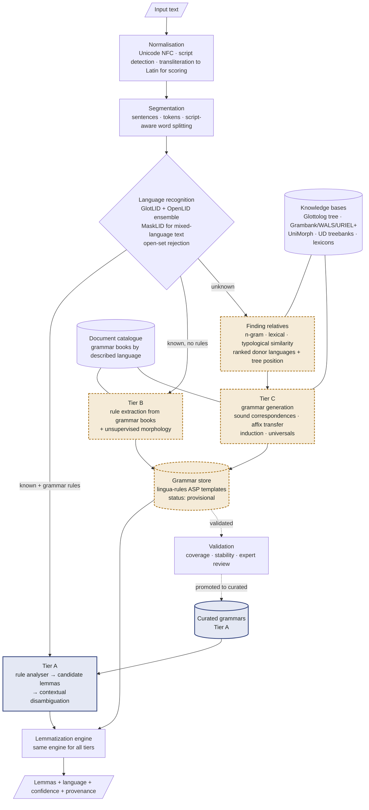

# Architecture schema

*Figure 1. Components and data flow. Solid blue marks curated knowledge; dashed ochre marks inferred knowledge that carries a confidence and waits for validation.*

## Components

| Component | Job | Method |
|----|----|----|
| Normalisation | Make text comparable across sources | Unicode NFC, removal of zero-width characters, script detection by Unicode script property (ISO 15924), romanisation (uroman-style) used only for similarity scoring, never for output |
| Segmentation | Sentences and word tokens | Rule-based for spaced scripts; dictionary/statistical segmentation for scripts without spaces (Thai, Chinese, Japanese) |
| Language recognition | Language label per segment, or "unknown" | Ensemble of fastText classifiers, code-switching detection, calibrated open-set rejection (section 3) |
| Finding relatives | For an unknown language: donors and tree position | Character n-gram, lexical (cognate) and typological similarity combined by a learned ranker (section 4) |
| Grammar store | One format for all grammars | Paradigm and rule templates in the lingua-rules ASP format, with confidence, provenance and status per rule |
| Lemmatization engine | Word → lemma in context | Rule analyser generates candidates; neural edit-script model scores them in context; guesser handles unknown words |
| Validation | Decide when inferred rules can be trusted | Corpus coverage, bootstrap stability, round-trip generation, held-out checks, expert review queue |
