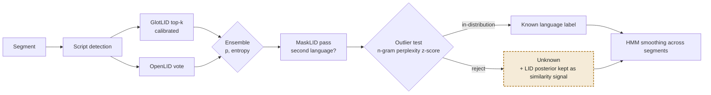

# Language recognition

Recognition answers two questions for every segment: which known language is it, and is it perhaps none of them. The second question matters most here, because a closed-set classifier always returns some label, even for a language it has never seen.

## Algorithm

1.  **Script first.** The dominant Unicode script restricts the candidate set (a Cyrillic text cannot be Hindi). Script is part of the label, as in GlotLID (`kaz_Cyrl` vs `kaz_Latn`).
2.  **Closed-set classification.** GlotLID v3 (fastText, 2,102 language–script labels, trained on 1,832 languages) returns the top-k labels with probabilities. OpenLID-v3 is added as a second vote because it was tuned for precision among closely related languages. Probabilities are calibrated per label (temperature scaling on held-out data) so that thresholds mean the same thing for every language.
3.  **Mixed-language text.** Segments are scored in sliding windows. MaskLID removes the features of the dominant language and re-classifies the remainder, which reveals an embedded second language without any extra training.
4.  **Open-set rejection.** A segment is marked *unknown* when any of these holds: the calibrated top probability is below τp; the entropy of the top-k distribution is above τH; or the text is an outlier for the winning label, i.e. its character n-gram perplexity under that language's model is far above the perplexity of that language's own validation texts (z-score above τz). The third test catches the dangerous case: a confident but wrong label for a relative of the true language.
5.  **Document-level smoothing.** Neighbouring segments rarely switch language, so labels are smoothed with a simple HMM over segments (switch penalty); isolated low-confidence flips are overruled.

*Figure 2. Recognition pipeline per segment. A rejected segment keeps its full probability distribution: it becomes the first similarity signal for finding relatives.*

    # language recognition for one document
    def recognise(doc):
        segments = segment(normalise(doc))
        labels = []
        for seg in segments:
            script = dominant_script(seg)
            dist = ensemble(glotlid.topk(seg, 20), openlid.topk(seg, 20), allowed_script=script)
            dist = calibrate(dist)                                   # per-label temperature
            top, p = dist.best()
            z = perplexity_zscore(seg, ngram_model[top])            # outlier for the winning label?
            if p < TAU_P or entropy(dist) > TAU_H or z > TAU_Z:
                labels.append(Unknown(posterior=dist, script=script))
            else:
                second = masklid(seg, dominant=top)                  # code-switching
                labels.append(Known(top, p, embedded=second))
        return hmm_smooth(labels, switch_penalty=SWITCH)
