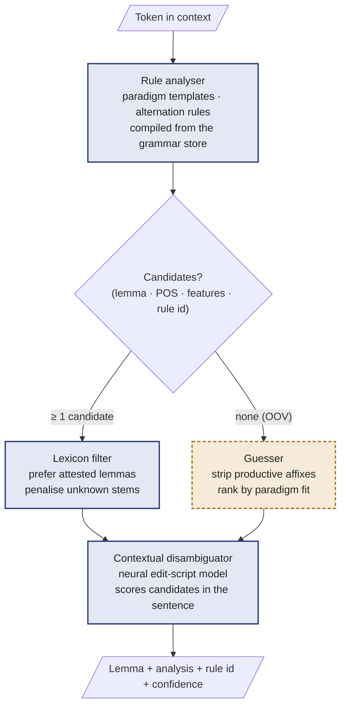

# Lemmatizing with existing rules (Tier A)

Where curated grammar exists, the system combines exact rules with a statistical model that reads context. Rules guarantee that every lemma is a legitimate form of the language; the model decides among ambiguous analyses (German *Weg* as noun "way" vs particle *weg*, Russian стали as "steel" or "became"). The design is deliberately two-stage: a symbolic **analyser** enumerates every lemma the grammar can justify, and a neural **disambiguator** chooses among them in context. The analyser bounds the output to real forms; the model resolves the ambiguity the analyser cannot. Neither stage can produce a lemma the other has not sanctioned.

*Figure 3. Tier A internal flow. The rule analyser produces the candidate set, the lexicon filter reweights it, and the contextual disambiguator selects one candidate; out-of-vocabulary tokens take the ochre guesser branch, whose output carries a lower confidence.*

1.  **Analysis.** Each token is run through the rule analyser (paradigm templates and alternation rules compiled from the grammar store). Running the paradigms in reverse, the analyser enumerates every (lemma, part of speech, morphological features) triple whose surface realisation equals the token, and tags each with the rule that produced it. For a regular form this set is usually small; for a syncretic form it can hold several analyses that share a spelling (Russian стали → *сталь* NOUN.Gen.Sg and *стать* VERB.Past.Pl). Each candidate is a hypothesis the grammar can defend, not a guess.
2.  **Lexicon check.** Candidates whose lemma is in the lexicon are preferred; unknown lemmas are allowed but penalised. The lexicon is a soft filter, not a gate: it reweights the candidate set so that attested stems outrank morphologically possible but unseen ones, while still letting a correct neologism through when the analyser is confident.
3.  **Unknown words.** When the analyser returns nothing — the stem is not in any paradigm — a guesser strips the most productive affixes (productivity = number of distinct stems observed with the affix) and proposes candidate lemmas ranked by paradigm fit. This is the only Tier A branch that leaves the curated grammar, so its output is marked with a lower confidence and an `origin` of `guessed`; it is the design's fallback for open vocabulary, not its normal path.
4.  **Contextual choice.** A neural edit-script lemmatizer (the approach of the Universal Lemmatizer [10] and Stanza/UDPipe, trained on Universal Dependencies) scores every candidate in its sentence. Rather than emit a free string, the model predicts the edit script — the sequence of character operations — that turns the form into its lemma, and this prediction is used only to *rank* the analyser's candidates: the output is constrained to the rule candidates whenever at least one exists, so the model cannot invent non-words. The chosen candidate carries the disambiguator's calibrated probability as its token confidence.

**What "explainable" means here.** Every Tier A lemma traces back to a single named rule in the grammar store: the `rule` field in the output (section 9) is the identifier of the paradigm or alternation that licensed the form, and the `origin` field records whether it came from the analyser, the lexicon or the guesser. A reviewer can therefore reconstruct *why* a given lemma was produced — which rule fired and which competing candidates the disambiguator ranked lower — without inspecting the neural model. The model moves probability mass between candidates; it never creates them.

Language-specific requirements for these steps (which alternations, exceptions and context rules are needed) are collected in [`languages/`](../languages/); for example, [Hungarian](../languages/hung1274-hungarian/en.md).
