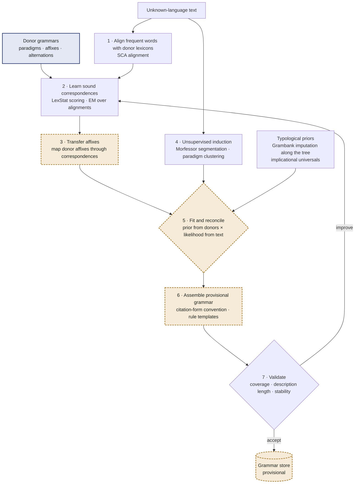

# Grammar generation for an unknown language (Tier C)

This is where the system uses the laws of language change. The working assumption is the comparative method's: related languages descend from a common ancestor, and the differences between them are largely *regular*. If the regular correspondences between the unknown language and its relatives can be learned, the relatives' morphology can be mapped onto the unknown language and then tested against its text.

*Figure 3. The grammar generation loop. Steps 2 to 7 repeat until the grammar's coverage and stability stop improving.*

## 1 · Lexical alignment

The 2,000 most frequent word types of the unknown text are aligned with the lexicons of the donors using sound-class alignment (SCA), which compares words by classes of similar sounds rather than exact letters. Where the orthography is not phonemic, a grapheme-to-phoneme step (Epitran-style) converts both sides to IPA first. Only pairs above a similarity threshold enter the next step.

## 2 · Sound correspondences

From the aligned pairs the system learns a correspondence table: which sound of the donor appears as which sound in the unknown language, in which context (e.g. donor p → target f at the start of a word; donor k → tʃ before front vowels). The LexStat principle is applied: a correspondence counts only if it recurs across many word pairs far more often than in randomly shuffled pairings, which filters out chance lookalikes and most loanwords. Estimation is an EM loop: correspondences re-score the alignments, better alignments refine the correspondences. Where several donors exist, the correspondence patterns across all of them are inferred jointly, which is more robust than pairwise tables.

## 3 · Affix transfer

Each affix of each donor paradigm is passed through the correspondence table, producing predicted target affixes with probabilities. A prediction survives if the predicted string actually occurs at the right edge (suffix) or left edge (prefix) of many different word types in the target text. For example, if a donor marks plural with `-at` and the table maps a → e, the system looks for a productive `-et` in the target.

## 4 · Unsupervised induction

In parallel, Morfessor FlatCat segments the target words into stems and affixes, and paradigm clustering groups words that share a stem and differ by affix sets. This step sees only the target text, so it also finds morphology that the donors do not have.

## 5 · Fitting and reconciliation

Transferred affixes are the prior, induced segmentation is the evidence. A hypothesis is scored by how much it shortens the description of the corpus (minimum description length: the grammar plus the corpus encoded with it). Typological priors decide close calls: missing Grambank features of the target are imputed from its position in the tree (phylogenetically weighted nearest neighbours), and implicational universals exclude improbable combinations. A suffixing-preference prior applies where the evidence is balanced, because suffixing is cross-linguistically far more common than prefixing.

## 6 · Assembly

Accepted affixes and alternations are organised into paradigms and written as lingua-rules templates. The lemma convention (which form counts as the dictionary form: nominative singular, infinitive, third person singular…) is copied from the closest donor, because that is what grammars of the family use. Every rule records its origin (transferred from which donor, induced, or both), its confidence and the number of supporting word types.

## 7 · Validation and iteration

The grammar is judged on the target text itself: share of tokens that receive an analysis (coverage), description length, stability of the rules under bootstrap resampling of the text, and round-trip consistency (generate forms from lemmas and check that they occur). Weak rules are dropped or re-estimated and the loop repeats. The final grammar is stored as *provisional*; it becomes curated only after review.

    # Tier C: derive a provisional grammar for unknown language U
    def generate_grammar(U_text, donors, position):
        words = frequent_types(U_text, 2000)
        induced = morfessor_flatcat(U_text) + paradigm_clusters(U_text)
        priors  = impute_grambank(position) + universals()
        corr = init_correspondences()                                  # identity + common sound changes
        for it in range(MAX_ITER):
            pairs = [align_sca(w, lexicon[d]) for d in donors for w in words]
            pairs = [p for p in pairs if lexstat_score(p, corr) > TAU_ALIGN]
            corr  = estimate_correspondences(pairs, shuffled_baseline=True)    # EM step
            transferred = [map_affix(a, corr) for d in donors for a in affixes(d)]
            transferred = [a for a in transferred if edge_support(a, U_text) >= MIN_TYPES]
            grammar = fit_mdl(prior=transferred, evidence=induced, typology=priors)
            score = validate(grammar, U_text)                          # coverage, MDL, bootstrap stability
            if score.gain < EPS:
                break
        grammar.lemma_convention = lemma_convention(closest(donors))
        return grammar.with_status("provisional", provenance=donors, confidence=score)
