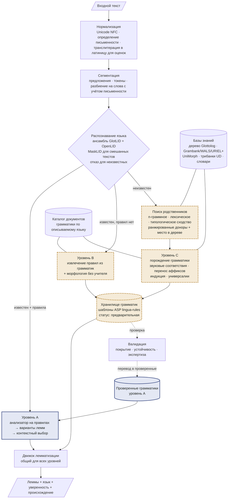

# Схема архитектуры

*Рис. 1. Компоненты и потоки данных. Сплошной синий — проверенные знания; пунктирный охристый — выведенные знания с оценкой уверенности, ожидающие проверки.*

## Компоненты

| Компонент | Задача | Метод |
|----|----|----|
| Нормализация | Сделать тексты из разных источников сопоставимыми | Unicode NFC, удаление символов нулевой ширины, определение письменности по свойству Unicode Script (ISO 15924), романизация (в духе uroman) только для оценки сходства, никогда для вывода |
| Сегментация | Предложения и словоформы | Правила для письменностей с пробелами; словарная/статистическая сегментация для письменностей без пробелов (тайская, китайская, японская) |
| Распознавание языка | Метка языка для каждого фрагмента или «неизвестен» | Ансамбль классификаторов fastText, обнаружение переключения кодов, откалиброванный отказ (раздел «Распознавание языка») |
| Поиск родственников | Для неизвестного языка: доноры и место в дереве | n-граммное, лексическое (когнаты) и типологическое сходство, объединённые обученным ранжировщиком |
| Хранилище грамматик | Единый формат всех грамматик | Шаблоны парадигм и правил в формате ASP lingua-rules; у каждого правила — уверенность, происхождение и статус |
| Движок лемматизации | Словоформа → лемма в контексте | Анализатор на правилах порождает варианты; нейросетевая модель скриптов редактирования оценивает их в контексте; угадыватель обрабатывает незнакомые слова |
| Валидация | Решить, когда выведенным правилам можно доверять | Покрытие корпуса, устойчивость на бутстрэп-выборках, обратная генерация, отложенные проверки, очередь на экспертизу |
