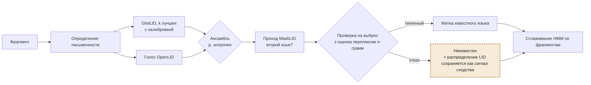

# Распознавание языка

Для каждого фрагмента распознавание отвечает на два вопроса: какой это известный язык — и не является ли он ни одним из них. Второй вопрос здесь важнее всего: классификатор с закрытым набором меток всегда выдаёт какую-то метку, даже для языка, которого никогда не видел.

## Алгоритм

1.  **Сначала письменность.** Основная письменность Unicode сужает набор кандидатов (кириллический текст не может быть на хинди). Письменность входит в метку, как в GlotLID (`kaz_Cyrl` и `kaz_Latn`).
2.  **Классификация по закрытому набору.** GlotLID v3 (fastText, 2 102 метки «язык–письменность», обучен на 1 832 языках) возвращает k лучших меток с вероятностями. OpenLID-v3 добавляется вторым голосом, так как настроен на точность среди близкородственных языков. Вероятности калибруются для каждой метки (температурное шкалирование на отложенных данных), чтобы пороги значили одно и то же для всех языков.
3.  **Смешанные тексты.** Фрагменты оцениваются скользящим окном. MaskLID маскирует признаки доминирующего языка и заново классифицирует остаток — так без дополнительного обучения обнаруживается вкраплённый второй язык.
4.  **Отказ для неизвестных.** Фрагмент помечается как *неизвестный*, если выполняется любое условие: откалиброванная максимальная вероятность ниже τp; энтропия распределения k лучших выше τH; текст нетипичен для победившей метки, т. е. его перплексия по символьным n-граммам под моделью этого языка намного выше перплексии собственных проверочных текстов языка (z-оценка выше τz). Третья проверка ловит самый опасный случай — уверенную, но ошибочную метку близкого родственника настоящего языка.
5.  **Сглаживание по документу.** Соседние фрагменты редко меняют язык, поэтому метки сглаживаются простой скрытой марковской моделью по фрагментам (штраф за переключение); одиночные неуверенные переключения отменяются.

*Рис. 2. Конвейер распознавания для одного фрагмента. Отвергнутый фрагмент сохраняет полное распределение вероятностей — это первый сигнал сходства при поиске родственников.*

    # распознавание языка для одного документа
    def recognise(doc):
        segments = segment(normalise(doc))
        labels = []
        for seg in segments:
            script = dominant_script(seg)
            dist = ensemble(glotlid.topk(seg, 20), openlid.topk(seg, 20), allowed_script=script)
            dist = calibrate(dist)                                   # температура для каждой метки
            top, p = dist.best()
            z = perplexity_zscore(seg, ngram_model[top])            # нетипичен для победившей метки?
            if p < TAU_P or entropy(dist) > TAU_H or z > TAU_Z:
                labels.append(Unknown(posterior=dist, script=script))
            else:
                second = masklid(seg, dominant=top)                  # переключение кодов
                labels.append(Known(top, p, embedded=second))
        return hmm_smooth(labels, switch_penalty=SWITCH)
