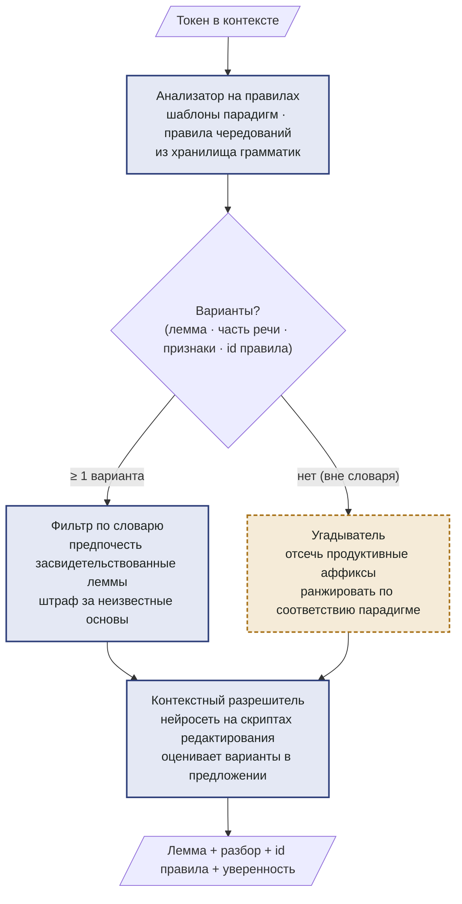

# Лемматизация по готовым правилам (уровень A)

Там, где есть проверенная грамматика, система сочетает точные правила со статистической моделью, учитывающей контекст. Правила гарантируют, что каждая лемма — допустимая форма языка; модель выбирает между неоднозначными разборами (нем. *Weg* — существительное «путь» или частица *weg*, рус. «стали» — «сталь» или «стать»). Схема сознательно двухступенчата: символьный **анализатор** перечисляет все леммы, которые способна обосновать грамматика, а нейросетевой **разрешитель неоднозначности** выбирает среди них по контексту. Анализатор ограничивает ответ реальными формами; модель снимает неоднозначность, которую анализатор снять не может. Ни одна ступень не порождает лемму, не санкционированную другой.

*Рис. 3. Внутренний поток уровня A. Анализатор на правилах порождает набор вариантов, фильтр по словарю меняет их веса, а контекстный разрешитель выбирает один вариант; токены вне словаря идут по охристой ветке угадывателя, выход которой несёт меньшую уверенность.*

1.  **Анализ.** Каждый токен проходит через анализатор на правилах (шаблоны парадигм и правила чередований из хранилища грамматик). Прогоняя парадигмы в обратную сторону, анализатор перечисляет все тройки (лемма, часть речи, морфологические признаки), поверхностная реализация которых совпадает с токеном, и помечает каждую правилом, её породившим. Для регулярной формы этот набор обычно мал; для синкретичной формы он может содержать несколько разборов с одинаковым написанием (рус. «стали» → *сталь* NOUN.Gen.Sg и *стать* VERB.Past.Pl). Каждый вариант — гипотеза, которую грамматика может защитить, а не догадка.
2.  **Проверка по словарю.** Варианты с леммой из словаря предпочтительнее; неизвестные леммы допускаются, но со штрафом. Словарь — мягкий фильтр, а не барьер: он меняет веса набора вариантов так, что засвидетельствованные основы оказываются выше морфологически возможных, но не встречавшихся, при этом правильный неологизм всё же проходит, когда анализатор уверен.
3.  **Незнакомые слова.** Когда анализатор ничего не возвращает — основы нет ни в одной парадигме, — угадыватель отсекает самые продуктивные аффиксы (продуктивность — число разных основ, с которыми встречен аффикс) и предлагает варианты лемм, ранжированные по соответствию парадигме. Это единственная ветка уровня A, покидающая проверенную грамматику, поэтому её выход помечается меньшей уверенностью и значением `origin` = `guessed`; это запасной путь схемы для открытого словаря, а не её обычный ход.
4.  **Выбор по контексту.** Нейросетевой лемматизатор на скриптах редактирования (подход Universal Lemmatizer [10] и Stanza/UDPipe, обучен на Universal Dependencies) оценивает каждый вариант в предложении. Вместо того чтобы выдать произвольную строку, модель предсказывает скрипт редактирования — последовательность операций над символами, превращающую форму в её лемму, — и это предсказание используется лишь для *ранжирования* вариантов анализатора: если есть хотя бы один вариант от правил, ответ ограничивается ими — модель не может выдумать несуществующее слово. Выбранный вариант несёт калиброванную вероятность разрешителя как уверенность токена.

**Что здесь значит «объяснимость».** Каждая лемма уровня A восходит к одному названному правилу в хранилище грамматик: поле `rule` в выводе (раздел 9) — это идентификатор парадигмы или чередования, санкционировавшего форму, а поле `origin` фиксирует, пришла ли она от анализатора, словаря или угадывателя. Поэтому рецензент может восстановить, *почему* получена именно эта лемма — какое правило сработало и какие конкурирующие варианты разрешитель поставил ниже, — не заглядывая в нейросеть. Модель перераспределяет вероятностную массу между вариантами, но никогда их не создаёт.

Требования конкретных языков к этим шагам — какие чередования, исключения и контекстные правила нужны — собраны в [`languages/`](../languages/); например, [венгерский](../languages/hung1274-hungarian/ru.md).
