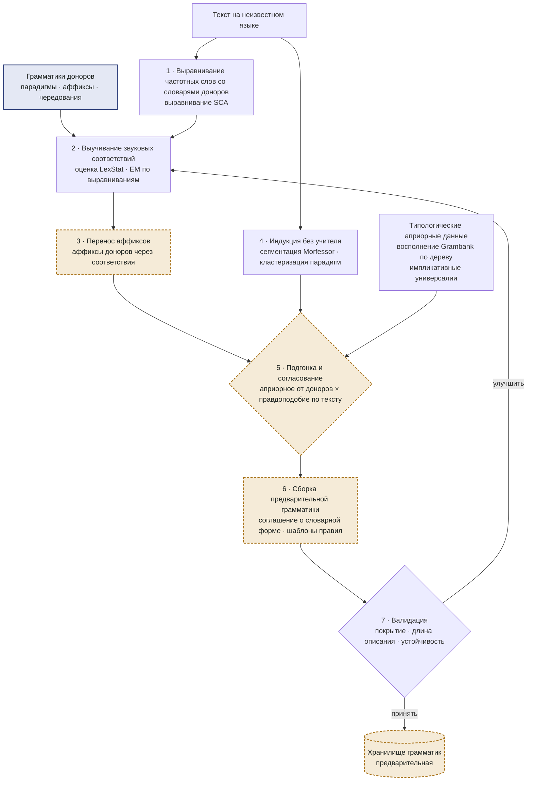

# Порождение грамматики неизвестного языка (уровень C)

Здесь система использует законы языковых изменений. Рабочее допущение — как в сравнительно-историческом методе: родственные языки происходят от общего предка, и различия между ними в значительной мере *регулярны*. Если выучить регулярные соответствия между неизвестным языком и его родственниками, морфологию родственников можно отобразить на неизвестный язык и затем проверить по его текстам.

*Рис. 3. Цикл порождения грамматики. Шаги 2–7 повторяются, пока покрытие и устойчивость грамматики перестают расти.*

## 1 · Лексическое выравнивание

2 000 самых частотных словоформ неизвестного текста выравниваются со словарями доноров методом выравнивания по звуковым классам (SCA), который сравнивает слова по классам сходных звуков, а не по точным буквам. Если орфография не фонематическая, сначала обе стороны переводятся в МФА (в духе Epitran). На следующий шаг попадают только пары выше порога сходства.

## 2 · Звуковые соответствия

По выровненным парам система строит таблицу соответствий: какой звук донора каким звуком выступает в неизвестном языке и в каком контексте (например, p донора → f в начале слова; k → tʃ перед передними гласными). Применяется принцип LexStat: соответствие учитывается, только если оно повторяется в множестве пар слов гораздо чаще, чем в случайно перемешанных парах, — это отсеивает случайные совпадения и большую часть заимствований. Оценка — цикл EM: соответствия переоценивают выравнивания, улучшенные выравнивания уточняют соответствия. Если доноров несколько, шаблоны соответствий выводятся для всех совместно, что надёжнее попарных таблиц.

## 3 · Перенос аффиксов

Каждый аффикс каждой парадигмы донора пропускается через таблицу соответствий, что даёт предсказанные аффиксы целевого языка с вероятностями. Предсказание сохраняется, если предсказанная цепочка действительно встречается на правом (суффикс) или левом (префикс) краю многих разных словоформ целевого текста. Например, если донор выражает множественное число через `-at`, а таблица отображает a → e, система ищет продуктивный `-et` в целевом тексте.

## 4 · Индукция без учителя

Параллельно Morfessor FlatCat сегментирует целевые слова на основы и аффиксы, а кластеризация парадигм объединяет слова с общей основой и разными наборами аффиксов. Этот шаг видит только целевой текст, поэтому находит и ту морфологию, которой у доноров нет.

## 5 · Подгонка и согласование

Перенесённые аффиксы — априорное знание, индуцированная сегментация — свидетельство. Гипотеза оценивается по тому, насколько она сокращает описание корпуса (минимальная длина описания: грамматика плюс корпус, закодированный с её помощью). Спорные случаи решают типологические априорные данные: недостающие признаки Grambank целевого языка восполняются по его месту в дереве (ближайшие соседи, взвешенные филогенетически), а импликативные универсалии исключают маловероятные сочетания. При равновесии свидетельств действует априорное предпочтение суффиксации, поскольку суффиксация в языках мира встречается гораздо чаще префиксации.

## 6 · Сборка

Принятые аффиксы и чередования организуются в парадигмы и записываются как шаблоны lingua-rules. Соглашение о лемме (какая форма считается словарной: именительный падеж единственного числа, инфинитив, 3-е лицо единственного числа…) берётся у ближайшего донора, потому что так принято в грамматиках этой семьи. Каждое правило хранит происхождение (перенесено от какого донора, индуцировано или и то и другое), уверенность и число подтверждающих словоформ.

## 7 · Валидация и итерации

Грамматика оценивается по самому целевому тексту: доля токенов, получивших разбор (покрытие), длина описания, устойчивость правил при бутстрэп-перевыборке текста и согласованность обратной генерации (формы, порождённые из лемм, должны встречаться в тексте). Слабые правила отбрасываются или переоцениваются, и цикл повторяется. Итоговая грамматика сохраняется как *предварительная*; проверенной она становится только после экспертизы.

    # Уровень C: вывод предварительной грамматики неизвестного языка U
    def generate_grammar(U_text, donors, position):
        words = frequent_types(U_text, 2000)
        induced = morfessor_flatcat(U_text) + paradigm_clusters(U_text)
        priors  = impute_grambank(position) + universals()
        corr = init_correspondences()                                  # тождество + частые звуковые изменения
        for it in range(MAX_ITER):
            pairs = [align_sca(w, lexicon[d]) for d in donors for w in words]
            pairs = [p for p in pairs if lexstat_score(p, corr) > TAU_ALIGN]
            corr  = estimate_correspondences(pairs, shuffled_baseline=True)    # шаг EM
            transferred = [map_affix(a, corr) for d in donors for a in affixes(d)]
            transferred = [a for a in transferred if edge_support(a, U_text) >= MIN_TYPES]
            grammar = fit_mdl(prior=transferred, evidence=induced, typology=priors)
            score = validate(grammar, U_text)                          # покрытие, MDL, устойчивость
            if score.gain < EPS:
                break
        grammar.lemma_convention = lemma_convention(closest(donors))
        return grammar.with_status("provisional", provenance=donors, confidence=score)
